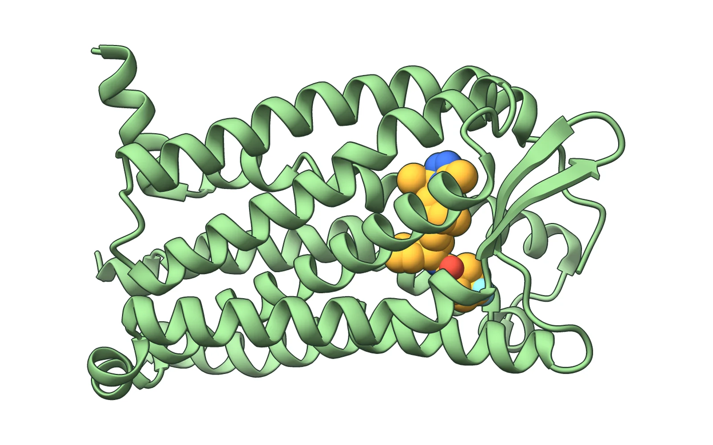
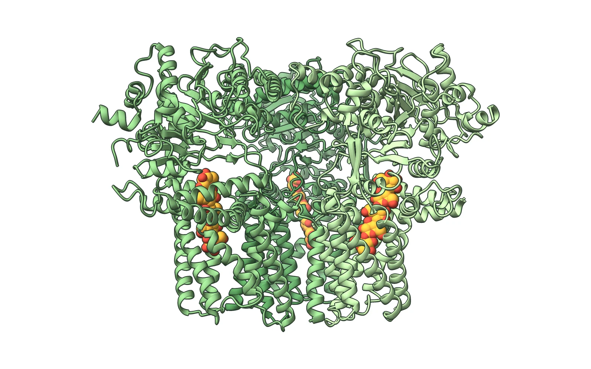
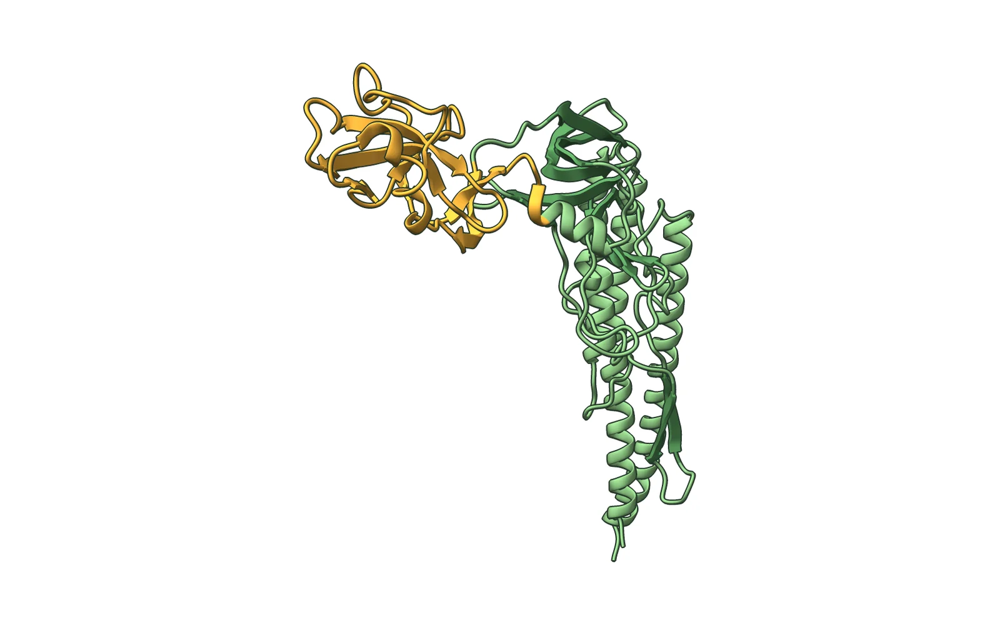
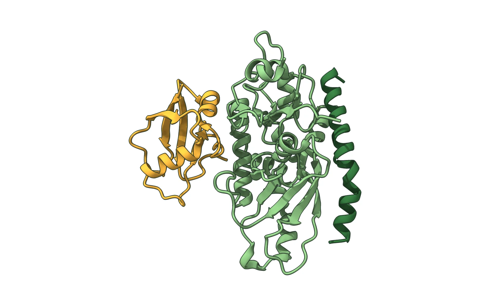

# Structure renders

A small, reproducible pipeline that turns PDB entries into a **consistent series of
publication-style protein figures** with ChimeraX and Python. These are the figures
used on [alvar56.github.io](https://alvar56.github.io).

| | |
| --- | --- |
|  |  |
| **CCR5 with maraviroc** · [PDB 4MBS](https://www.rcsb.org/structure/4MBS) — the HIV co-receptor with the entry inhibitor bound in its pocket | **Cellulose synthase trimer** · [PDB 6WLB](https://www.rcsb.org/structure/6WLB) — three CesA subunits with the glucan chains they extrude |
|  |  |
| **_Salmonella_ flagellin** · [PDB 1IO1](https://www.rcsb.org/structure/1IO1) — the variable D3 domain, which defines the serotype, in amber | **ATG12–ATG5–ATG16** · [PDB 4GDK](https://www.rcsb.org/structure/4GDK) — the complex that attaches ATG8 to membranes |

## Why

Figures made one by one drift apart: different lighting, colours, zoom and framing. Here
every figure is a short **recipe** (which entry, what to delete, what to highlight, how to
turn it) applied to one shared **house style**, and a second step puts every molecule on
an identical canvas. Adding a figure means adding five lines, and re-styling the whole set
means changing one.

## Run

Requirements: [ChimeraX](https://www.cgl.ucsf.edu/chimerax/) 1.6+ and Python 3.9+ with Pillow.

```bash
chimerax --nogui --offscreen --script "scripts/render.py"        # every figure -> build/*.png
chimerax --nogui --offscreen --script "scripts/render.py ccr5"   # just one
python scripts/frame.py --fill 0.8                               # build/ -> figures/*.webp
```

On Windows, run ChimeraX without `--nogui --offscreen` (`ChimeraX-console.exe --script ...`).

## How it works

- **`scripts/render.py`** (runs inside ChimeraX). Fetches each entry from the PDB, removes
  solvent, fusion partners or extra copies, draws a cartoon in the house greens, shows the
  ligand as spheres in amber with element colours, orients the molecule and saves a 1600 × 1000
  render with 3× supersampling.
- **House style.** Ambient-occlusion lighting from 512 directions, no depth fog, a thin dark
  silhouette and a dull material: shape reads from shading, not from glossy highlights.
- **`scripts/frame.py`** (plain Python). Crops each render to its content, scales it so the
  molecule fills the same fraction of the canvas, and centres it on a white 16:10 WebP.

Adding a figure:

```python
'myprotein': {
    'pdb': '1abc',
    'prepare': ['delete ligand'],
    'colour': [f'color #1 {GREEN} target c', f'color #1 & :50-120 {AMBER} target c'],
    'ligand': None,
    'turns': ['turn y 40'],
},
```

## Related

- [tonoplast-scenes](https://github.com/Alvar56/tonoplast-scenes) — animated Blender +
  Molecular Nodes scenes at the plant vacuole membrane.

## Author

Alvar Pascual García, biotechnologist (MSc, BOKU Vienna) ·
[alvar56.github.io](https://alvar56.github.io)
